<p align="center">
  
</p>

<h1 align="center">shhtml</h1>

<p align="center">
  <b>Publish HTML quietly.</b><br>
  Private pages on your own domain, put online by Claude Code or Codex.
</p>

<p align="center">
  <a href="#install"></a>
  <a href="#install"></a>
  <a href="#why-shhtml"></a>
  <a href="./LICENSE"></a>
</p>

<p align="center">
  
</p>

Your agent makes a dashboard, a report, or a whole site. You say **"publish this as finance."** You get back `https://static.yourdomain.com/finance`. Only the people on your list can open it.

It runs on a Cloudflare account you already have. There is no server to look after and no bill.

## Why shhtml

- **Private by default.** Every page sits behind a Cloudflare sign-in. Viewers get a one-time code by email. Nobody needs an account.
- **Your domain.** Links live on `static.yourdomain.com`, not on someone else's site.
- **One sentence.** Your agent checks the page, uploads it, and hands back the link.
- **Free.** Storage, hosting, and sign-in all fit Cloudflare's free plan, which covers up to 50 people.

## Install

Run each line on its own.

**Claude Code**

```
/plugin marketplace add latecommitlab/shhtml
/plugin install shhtml@shhtml
```

**Codex**

```
codex plugin marketplace add latecommitlab/shhtml
codex plugin add shhtml@shhtml
```

## Set up your instance

Do this once. You need:

- a domain on Cloudflare
- a free Zero Trust team, made at [one.dash.cloudflare.com](https://one.dash.cloudflare.com)
- Node 18 or later
- a Cloudflare API token with Workers Scripts, Workers R2 Storage, Access: Apps and Policies, DNS, and Workers Routes

Start setup with `/shh-setup` in Claude Code. In Codex, type `$` and pick **shh-setup**. Then tell it your domain and who may publish:

> Set up shhtml for example.com, and let me@example.com publish.

It makes the storage, the two web addresses, and the sign-in rules, then walks you through the deploy. It takes about ten minutes.

Someone already set one up for you? Just ask:

> Connect shhtml to https://publish.example.com and https://static.example.com, then sign me in.

## Use it

> Publish this page as finance.
>
> Put the ./build folder online as q3-report.
>
> Give me a link to this dashboard that I can drop in Slack.

The first time, a browser tab opens and you sign in by email. After that, publishing is just an upload. If a name is already taken, your agent asks before it replaces the page.

## Who can see a page

Two Cloudflare Access apps decide. Change them in the Zero Trust dashboard.

| App | Guards | Decides |
| --- | --- | --- |
| shhtml publisher | `publish.example.com/auth` | who can publish |
| shhtml viewer | `static.example.com` | who can view |

Both start with the emails you gave at setup. To make one page public, add an Access app for `static.example.com/that-page` with a Bypass rule for Everyone.

<details>
<summary><b>How it works</b></summary>
<br>

```text
viewing                           publishing
-------                           ----------
browser                           your agent runs the shh CLI
   |                                 |
static.yourdomain.com             publish.yourdomain.com
   |                                 |
Cloudflare Access                 /auth sits behind Cloudflare Access
(who may view)                    and hands out a 30-day upload token
   |                                 |
Worker serves files from R2  <--  Worker writes files to R2
```

Files live in an R2 bucket. One small Worker reads and writes them. Cloudflare Access handles every sign-in.

</details>

<details>
<summary><b>Security</b></summary>
<br>

- Uploads need a signed token. You get one only by signing in through Cloudflare Access, and it lasts 30 days.
- The signing secret lives in Cloudflare's secret store, never in code.
- Upload paths are checked: no `..` and no hidden files.
- Cloudflare checks every viewer before the Worker runs. If the Worker fails, no page leaks.
- Pages go out with no-sniff, no-framing, and strict referrer headers.

shhtml is a private shelf for pages, not a vault. Don't use it for secrets, personal data, or anything regulated.

</details>

<details>
<summary><b>Run the <code>shh</code> command yourself</b></summary>
<br>

Your agent runs a small CLI for you. To run it by hand, clone the repo and link the CLI into a folder on your PATH:

```
git clone https://github.com/latecommitlab/shhtml
ln -s "$PWD/shhtml/plugin/skills/shh/scripts/shh" ~/.local/bin/shh
```

| Command | Does |
| --- | --- |
| `shh init <publish-url> <static-url>` | points this machine at an instance |
| `shh login` | signs you in |
| `shh publish <name> <files…>` or `--dir <folder>` | publishes |
| `shh whoami` | shows who is signed in |

It needs only bash, curl, and python3.

</details>

<details>
<summary><b>Set up by hand</b></summary>
<br>

The setup skill runs these for you. From a clone of this repo:

```
CLOUDFLARE_API_TOKEN=... plugin/skills/shh-setup/scripts/provision \
  --zone example.com \
  --publish-host publish.example.com \
  --static-host static.example.com \
  --emails you@example.com \
  --worker-dir ./worker

cd worker
npx -y wrangler@4 deploy
openssl rand -hex 32 | npx -y wrangler@4 secret put SIGNING_SECRET
```

The provisioner is safe to run again. It creates the R2 bucket, both DNS records, and both Access apps, then writes `worker/wrangler.toml`. That file holds your account and domain, so git ignores it. Keep this clone, because later deploys need that file.

</details>

## Develop

```
cd worker && npm test                      # worker tests
plugin/skills/shh/scripts/shh selftest     # CLI checks
```

## Star history

<a href="https://www.star-history.com/#latecommitlab/shhtml&Date">
  <picture>
    <source media="(prefers-color-scheme: dark)" srcset="https://api.star-history.com/svg?repos=latecommitlab/shhtml&type=Date&theme=dark">
    
  </picture>
</a>

## License

[MIT](./LICENSE)
